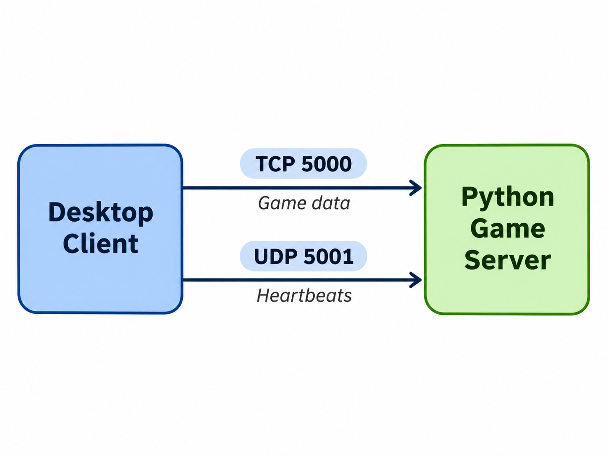
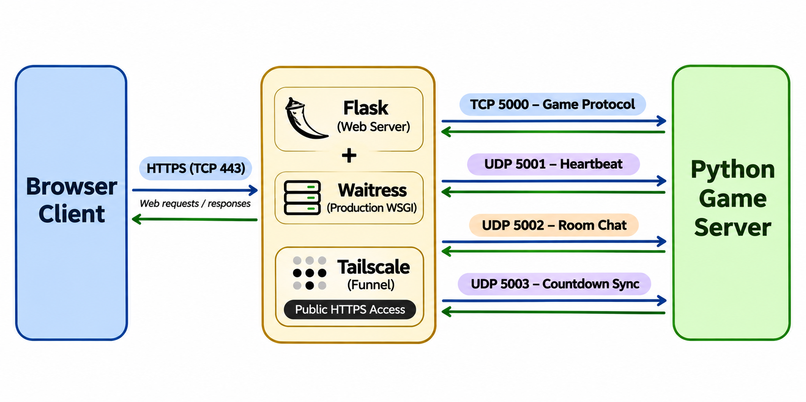

# ✊✋✌️ RPS Arena: Multiplayer Rock-Paper-Scissors

A real-time **multiplayer Rock-Paper-Scissors game** built on raw network programming. One Python game server handles accounts, rooms, matches and scores, and players join from either a **desktop app (Tkinter)** or a **web browser**.

CS411 project at MedTech – South Mediterranean University. The focus is on **choosing the right protocol for each job**: TCP, UDP, HTTP and HTTPS.

## Features

- 🔐 Account registration & login, with passwords hashed using **PBKDF2-HMAC (250,000 iterations) + per-user salt** in SQLite
- 🏠 Create and join game rooms, play rounds, and track scores and winners
- 🖥️ **Desktop client** (Tkinter) talking directly to the server over TCP
- 🌐 **Browser client** (Flask + Waitress) that can be published online with **Tailscale Funnel**
- ⏱️ UDP countdown and in-room chat
- 📡 **Network monitor**: live ping, packet loss and jitter measured over UDP
- 🔌 Disconnection detection using heartbeats and presence messages
- 🛡️ Rate limiting on login/registration (Flask-Limiter) and secrets loaded from `.env`

## Architecture & protocols

| Link | Protocol / port | Used for | Why |
|---|---|---|---|
| Desktop client ↔ game server | **TCP 5000** | Login, rooms, moves, scores | Reliable, ordered delivery: no lost moves |
| Desktop client ↔ game server | **UDP 5001** | Heartbeats, ping/loss/jitter probes, countdown, chat | Lightweight; one lost packet doesn't matter |
| Browser ↔ Tailscale Funnel | **HTTPS 443** | All browser traffic | Encrypted over the internet |
| Funnel ↔ Flask/Waitress | **HTTP 8000** | Forwarded web requests | Local hop to the web app |
| Flask ↔ game server | **TCP 5000** | Same game actions as the desktop client | Single source of truth for the game state |

The browser gets game updates by **HTTP polling** (about once per second). A player is considered disconnected after roughly 25 s without activity, and is then removed from their room.

| Desktop app | Browser app |
|---|---|
|  |  |

## Project structure

```
server/server.py          Game server: accounts (SQLite), rooms, matches, TCP + UDP
client/client.py          Desktop client (Tkinter)
web/app.py                Flask web app (served by Waitress) that bridges browsers to the game server
web/udp_chat_bridge.py    UDP chat bridge for browser players
web/static, templates     Browser UI (HTML/CSS/JS)
docs/                     Communication design document and diagrams
```

## Run it locally

```bash
pip install flask flask-limiter waitress python-dotenv
cp .env.example .env        # then set RPS_FLASK_SECRET to a long random string

python server/server.py     # terminal 1: game server
python client/client.py     # terminal 2: desktop client
python web/app.py           # terminal 3: web app at http://127.0.0.1:8000
```

To put the web version online: `tailscale funnel 8000`.

## Tech stack

Python · sockets (TCP/UDP) · SQLite · Tkinter · Flask · Waitress · JavaScript · Tailscale

📄 [Communication design document](docs/communication-design.pdf)
